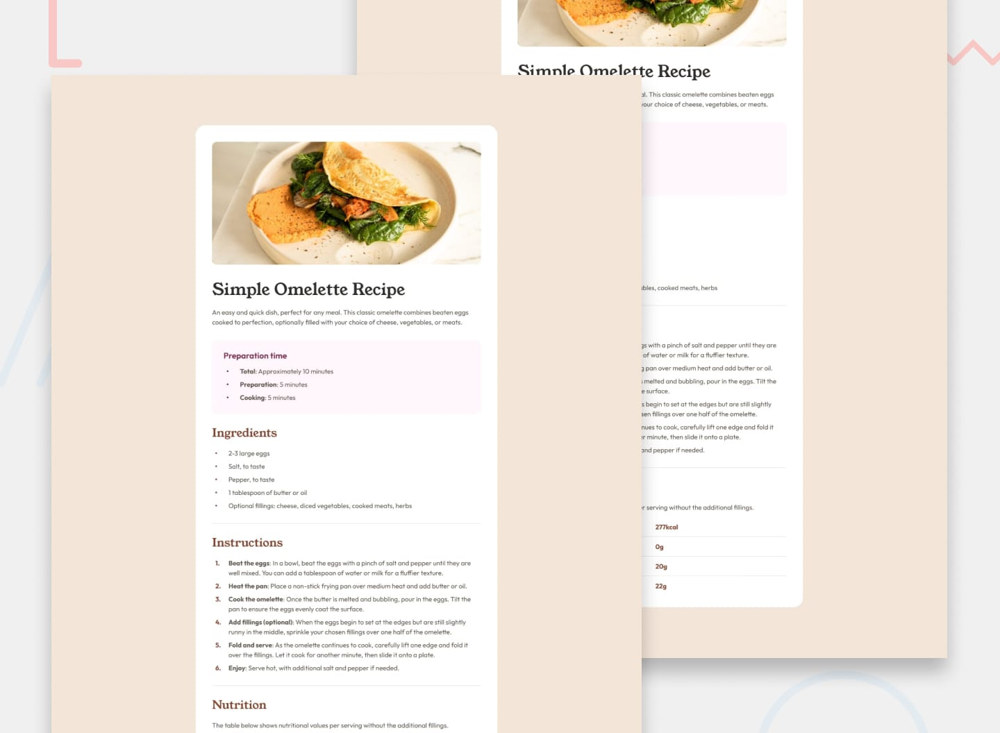

# Recipe Page

Solução para o desafio **Recipe Page** do Frontend Mentor. O projeto reproduz uma página de receita responsiva, com informações sobre tempo de preparo, ingredientes, instruções e valores nutricionais.

## Visão geral

O objetivo foi transformar as referências visuais do desafio em uma interface responsiva, priorizando HTML semântico, acessibilidade básica e fundamentos de CSS.

O layout possui três comportamentos principais:

- desktop com o conteúdo centralizado em um cartão;
- tablet com redução do espaço disponível ao cartão;
- mobile com imagem ocupando toda a largura e conteúdo com recuo próprio.

## Preview



## Tecnologias

- HTML5
- CSS3
- CSS Custom Properties
- CSS Nesting
- Media Queries
- Google Fonts

## Principais decisões

- Uso de `main` e `article` para representar o conteúdo principal e a receita.
- Separação do conteúdo em regiões semânticas com `header`, `aside` e `section`.
- Uso de listas para ingredientes e instruções.
- Uso de tabela com `th` e `scope="row"` para os dados nutricionais.
- Organização de cores, tipografia e espaçamentos como custom properties.
- Implementação desktop-first, com adaptações para tablet e mobile.
- Separação entre a imagem e o container textual para permitir que a imagem alcance as bordas no mobile.
- Uso de propriedades lógicas, como `margin-block`, `padding-inline` e `margin-inline`.

## Conceitos praticados

- Estrutura e hierarquia semântica do HTML.
- Box model e controle de espaçamentos.
- Herança, cascata e especificidade no CSS.
- Seletores, pseudo-classes e o pseudo-elemento `::marker`.
- Estrutura semântica e estilização de tabelas.
- Criação e utilização de design tokens.
- Responsividade com media queries.
- Identificação e remoção de regras CSS redundantes.

## Como executar

Clone o repositório e abra o arquivo `index.html` no navegador. Também é possível servir o diretório com um servidor local de sua preferência.

```bash
git clone https://github.com/Lucas-G4ldin0/Frontend-Mentor.git
cd Frontend-Mentor/Newbie/recipe-page
```

## Melhorias futuras

- Restringir o carregamento do Outfit aos pesos utilizados no projeto.
- Informar as dimensões intrínsecas da imagem para reduzir layout shift.
- Publicar o projeto e incluir a URL da versão online.

## Autor

Desenvolvido por [Lucas Galdino](https://github.com/Lucas-G4ldin0).
